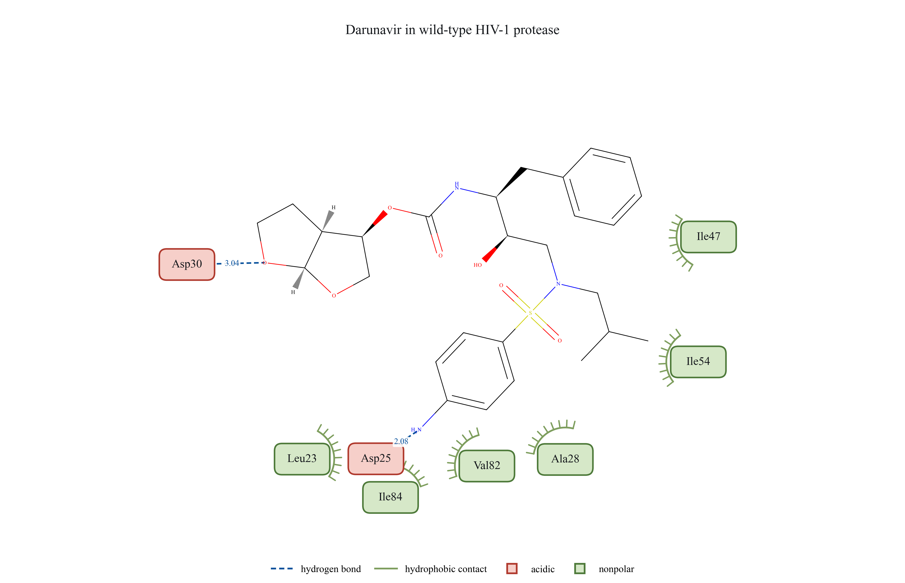

# POSEPRINT

Protein-ligand interaction fingerprints from docked poses.

POSEPRINT reads a docked complex and reports, residue by residue, which of seven
interaction types it makes with the ligand. It answers the question a docking score does
not, which is *where* and *how* a pose binds.

It was written for the CLINCH study of HIV-1 protease inhibitor design, where it read
142,160 docked poses of 3,949 ligands. Nothing in it is specific to that target.

---

## The seven interaction types

| Type | What is detected |
| --- | --- |
| Hydrogen bond | donor, hydrogen and acceptor, with a distance and an angle cutoff |
| Hydrophobic contact | apolar ligand carbon against an apolar residue atom |
| Salt bridge | charged ligand group against an oppositely charged residue, both directions |
| Water bridge | ligand and residue hydrogen bonded through the same water |
| Pi stacking | parallel, offset parallel and T-shaped, between aromatic rings |
| Pi-cation | a cation over an aromatic ring, in either direction |
| Halogen bond | ligand halogen to a protein acceptor, with the sigma-hole angle |

---

## Install

```bash
git clone https://github.com/<your-account>/poseprint.git
cd poseprint
pip install -e .
```

Add the browser interface with `pip install -e ".[app]"`.

[Open Babel](https://openbabel.org) is recommended but not required. POSEPRINT needs the
complex in MOL2 as well as PDB, because MOL2 carries the bond orders and aromatic flags
that ring perception depends on. Open Babel makes that file, and it is what produced the
files behind the published labels. Without it the conversion falls back to MDAnalysis,
which guesses bonds from distances, so the aromatic interactions can differ. Hydrogen
bonds and hydrophobic contacts do not depend on that file.

---

## Use it from Python

```python
from poseprint import analyse

for result in analyse("complex.pdb"):
    print(result.ligand, result.counts())
    print(result.contact_table())
```

```
UNK900 {'H-bonds': 2, 'Hydrophobic interaction': 6, ...}

Residues  H-bonds  Hydrophobic interaction  H-bond Distance  H-bond Angle
  LEU 23      0.0                      1.0             0.00          0.00
  ASP 25      1.0                      0.0             2.08        152.24
  ALA 28      0.0                      1.0             0.00          0.00
  ASP 30      1.0                      0.0             3.04        156.64
  ILE 47      0.0                      1.0             0.00          0.00
```

For the reduced form that a scoring or learning model usually wants:

```python
from poseprint import fingerprint

fp = fingerprint("complex.pdb")[0]
fp["hbond_count"]            # 2
fp["hbond_residues"]         # ['ASP 25', 'ASP 30']
fp["hydrophobic_count"]      # 6
fp["hydrophobic_residues"]   # ['LEU 23', 'ALA 28', 'ILE 47', 'ILE 54', 'VAL 82', 'ILE 84']
```

---

## Use it from the command line

```bash
poseprint complex.pdb                              # one row, printed
poseprint "poses/*.pdb" -o fingerprints.csv        # one row per pose
poseprint complex.pdb --full -o table.csv          # the per-residue table
poseprint "poses/*.pdb" -o results/                # one CSV per pose
```

---

## The report, one row per contact

The per-residue table counts contacts. The report says what each one is, which atoms
made it and how far apart they are.

```python
from poseprint import analyse

result = analyse("complex.pdb")[0]
print(result.log)              # the report as POSEPRINT writes it
result.log_table()             # the same thing as a table
```

```
   interaction partner 1 partner 2        atoms  distance  angle
 Hydrogen bond    ASP 30   UNK 900     N, H, O5      3.04 156.64
 Hydrogen bond   UNK 900    ASP 25 N3, H35, OD2      2.08 152.24
   Hydrophobic   UNK 900    ILE 54          NaN      3.60    NaN
   Hydrophobic   UNK 900    ILE 47          NaN      3.29    NaN
```

```bash
poseprint complex.pdb --log reports/     # the text report and the CSV, per ligand
```

In the browser the same table appears under **Detected interactions**, with a button to
take it as CSV and another to take the report as written.

Hydrogen bonds, water bridges and halogen bonds name the atoms that made the contact.
Hydrophobic contacts, salt bridges and the aromatic interactions are reported per residue,
so their atom column is empty.

---

## A figure for the manuscript



```python
from poseprint import draw_diagram

draw_diagram("complex.pdb", out="interactions.pdf",
             title="Darunavir in wild-type HIV-1 protease")
```

```bash
poseprint complex.pdb --diagram figures/            # PDF by default
poseprint "poses/*.pdb" --diagram figures/ --diagram-format svg
```

The ligand is drawn as a structure and the residues that touch it sit around it, each one
labelled in the usual way, `Asp25`, `Ile84`, and coloured by class. Every interaction
that names a ligand atom is drawn as a dashed line straight to that atom with the
distance on it. Hydrophobic contacts carry no atom in the detector output, so they are
drawn the way LigPlot draws them, as a spoked arc facing the nearest ligand atom.

| Colour | Residue class |
| --- | --- |
| green | nonpolar, Ala Val Leu Ile Pro Met Phe Trp Gly |
| blue | polar, Ser Thr Cys Asn Gln Tyr |
| red | acidic, Asp Glu |
| purple | basic, Lys Arg His |

PDF and SVG come out vector, so the figure stays sharp at any size in a manuscript and a
label can still be nudged in Illustrator or Inkscape. The browser interface offers the
same three formats as download buttons.

---

## Use it in the browser

```bash
streamlit run app/streamlit_app.py
```

Drop in a complex and the page reports the contacts, draws the structure in three
dimensions with the contacting residues coloured by interaction type, renders the
interaction diagram, and offers the table as a CSV and the figure as PDF, SVG or PNG. A second
tab takes a batch of poses and returns one row each.

---

## What the input has to look like

**Protein and ligand in one PDB file.** The ligand is read from the `HETATM` records, so
a separate ligand file is not used.

**Hydrogens have to be present.** Hydrogen bonds are found through the donor hydrogen, so
a heavy-atom-only file returns nothing rather than failing. Add them with
`obabel -ipdb in.pdb -opdb -O out.pdb -h` or with your preparation tool of choice.

**Every atom in a residue needs its own name.** Any PDB parser keeps one atom per name
per residue, so a ligand whose seventy-five atoms are all called `C` or `H` collapses to
a handful of atoms and no interaction is found. Some preparation tools leave ligand atom
names blank. `examples/make_example.py` shows how to generate them.

---

## How to read the numbers

The table carries one row for each residue and one row for the ligand itself. Every
contact appears twice, once against the residue and once against the ligand, so the
**ligand row is the total** and summing a whole column would double count. `counts()`
reads the ligand row for that reason.

A residue label carries the residue name and number but **not the chain**. In a homodimer
the two copies of a residue therefore share one label and one count. The CLINCH study
folded the HIV-1 protease dimer onto one 99-residue monomer for exactly this reason.

---

## Try it

The repository ships with wild-type HIV-1 protease and darunavir, the prepared complex
that entered the molecular dynamics in the CLINCH study.

```bash
poseprint examples/hiv1_protease_darunavir.pdb
```

POSEPRINT finds hydrogen bonds to **Asp25** and **Asp30** and hydrophobic contacts to
**Leu23, Ala28, Ile47, Ile54, Val82 and Ile84**, which is the binding mode darunavir is
known for. `tests/test_poseprint.py` pins those contacts, so a change to a detector that
moves them fails the suite.

---

## Tests

```bash
pip install -e ".[dev]"
pytest
```

---

## Citation

If POSEPRINT is useful in your work, please cite the CLINCH paper. A reference will be
added here once it is published.

---

## Licence

MIT, see [LICENSE](LICENSE).
